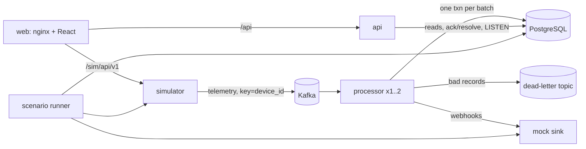
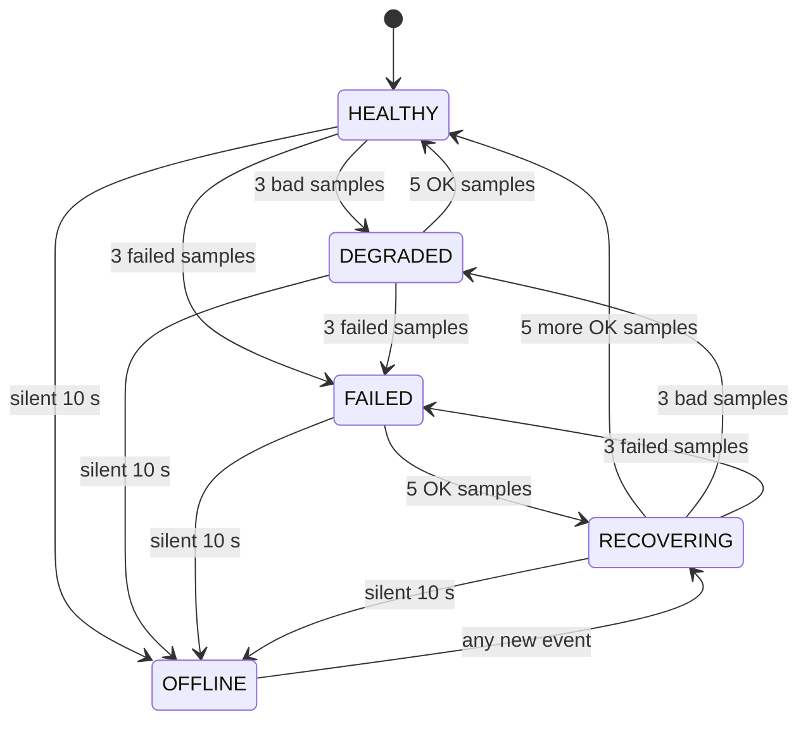

# FleetPulse architecture

Status: partly built. Working today: the simulator with chaos controls and ledger, ingest with dedupe, ordering, dead-letter handling and retention, the REST read model with live SSE updates, the fleet grid and device detail, and the scenario runner. Still to come: device health state machine, alerts and webhooks, mock sink, faults and disconnects, offline sweep, metrics and trace export with dashboards. Numbers below are targets for a single laptop (16 GB RAM, 8 cores, Docker Desktop) until measured.

## What it is

FleetPulse simulates 1000 devices sending about 1000 events per second, tracks each device's health, raises alerts, and delivers them as webhooks. The point of the project is reliability under bad conditions: duplicate and out-of-order events, disconnected devices, clock skew, and components being killed or restarted. A chaos scenario runner breaks things on purpose and then reconciles what the simulator sent against what the database applied, printing PASS or FAIL.

Everything runs locally with `docker compose up`. There is no auth; see [Out of scope](#out-of-scope).

## Components

| Component | Job |
|---|---|
| simulator | 1000 devices, heartbeat and telemetry every 2 s each. Chaos controls: duplicates, drops, reordering, clock skew, disconnects with buffered replay, malformed records. Keeps a ledger of every event Kafka acknowledged. |
| processor | Consumes from Kafka, validates, dedupes, applies events in order, runs the device state machine and alert rules, marks silent devices OFFLINE, delivers webhooks from an outbox. Can run as two replicas. |
| api | REST for the UI and scripts, alert ack/resolve, Server-Sent Events for live updates. |
| web | React UI behind nginx: fleet grid, device detail, alert list, chaos panel. |
| sink | Mock webhook receiver with failure modes (error rate, delay, outage). Records every idempotency key it sees. |
| Kafka, PostgreSQL | One broker, one database. Kafka topic `fleetpulse.telemetry.v1` has 6 partitions keyed by device id. |
| OTel Collector, Prometheus, Tempo, Grafana | Metrics, traces, dashboards. |

Interface specs are in [`../contracts/`](../contracts/).

## One event, end to end

1. The simulator creates an event with a fixed `event_id`, a per-device `seq`, and an `epoch` (the simulator's boot time). It sends it with key = device id. When Kafka acks, the event is "accepted" and goes into the ledger. From here on it must not be lost.
2. The broker stamps it with its own append time.
3. The processor polls a batch (up to 500 records) and validates each one. Bad records go to a dead-letter topic with a reason; the batch keeps going.
4. In one database transaction: insert all event ids into an inbox table (duplicates are skipped there), lock the affected device rows, apply each device's new events in `(epoch, seq)` order, write state changes, alerts and outbox rows, and send a change notification.
5. Commit, then commit the Kafka offsets. If the processor dies in between, Kafka redelivers and the inbox drops the repeats.
6. The api gets the notification, re-reads the changed rows, and pushes them to browsers over SSE at most 4 times a second.

Target latency from Kafka ack to database commit: p95 under 500 ms. To the browser: p95 under 1 s.

## Duplicates and out-of-order events

- **Duplicates** are caught by the inbox's primary key on `event_id`. A duplicate changes nothing. The inbox keeps 30 minutes of ids, longer than the worst expected replay or redelivery delay.
- **Ordering** is by `(epoch, seq)`, never by device time. Each device always lands on the same partition, so Kafka keeps its events in order unless the simulator reorders them on purpose.
- **Late events** (seq at or below the last applied one) are recorded and counted but never change current state.
- **Gaps** in seq are counted and processing moves on; it never waits for a missing event.
- **Simulator restarts** start a new epoch, so new events sort after old ones and get new ids.

## Device states

- **New devices**: there is no seed data. A device row is created by the device's first event and starts HEALTHY, with no history entry and no alert. From there its samples move it like any other device.
- Each telemetry sample is OK, DEGRADED or FAILED depending on thresholds in [`rules.yaml`](../contracts/rules.yaml) (for example temperature 70 C and up is degraded, 85 C and up is failed).
- Hysteresis counts samples in order, not seconds: 3 bad samples to get worse, 5 good ones to get better. A replayed burst behaves exactly like live data, and clock skew can't affect it. At one sample per 2 s that is about 6 s to raise and 10 s to clear.
- **Offline**: a device with no new event for 10 s goes OFFLINE. "Last seen" is the broker's append time, not the device clock, so a skewed clock never makes a live device look dead. The sweep runs every second.
- **No false offline when the processor is behind**: if any Kafka partition has more than 1000 unprocessed records, the sweep skips, and after lag clears it waits another 10 s. Otherwise a processor restart would mark every device OFFLINE while it caught up.
- **Recovery**: the first event from an OFFLINE device moves it to RECOVERING; 5 OK samples make it HEALTHY.

## Alerts and webhooks

- Five rules: temperature high, battery low, error burst (metric rules) and device offline, device failed (state rules).
- At most one open alert per device and rule, enforced by a unique index.
- Lifecycle: OPEN -> ACKED -> RESOLVED, or OPEN -> RESOLVED. Metric alerts auto-resolve after 5 clear samples. If an operator resolves one while the condition still holds, a new alert opens after 3 more bad samples.
- **Backfilled alerts**: when a device reconnects and replays buffered events that contain a fault that already ended, the alert is still opened and resolved, both webhooks are sent, and both carry `backfilled: true`. Faults during a disconnect are not hidden.
- **Webhooks** use a transactional outbox: the outbox row is written in the same transaction as the alert change, and a worker delivers it afterwards. Delivery is at-least-once with a stable idempotency key per transition. Retries back off from 1 s doubling to 30 s, up to 20 attempts (about 7.5 minutes). Rows that run out of attempts are marked dead, kept, and counted. Transitions of one alert are delivered in order.

## Live UI

The browser opens an SSE stream, fetches a REST snapshot, and then applies stream updates. Each device and alert carries a version number, so out-of-order or repeated updates are ignored. On any reconnect the client re-fetches the snapshot instead of trying to replay missed events. Target: the UI matches the server within 5 s of reconnecting.

## API errors

The api and the simulator control API return errors as `application/problem+json` (RFC 9457), never stack traces. Each body has a `code` and a `type` of `urn:fleetpulse:problem:<code>` with the code lowercased and `_` turned into `-`, for example `urn:fleetpulse:problem:validation-failed`. Codes: `VALIDATION_FAILED` (400, bad fields listed in `errors`; also used for 405, 411 and 413 since the `status` field carries the real status), `NOT_FOUND` (404), `ALERT_RESOLVED` (409), `UNSUPPORTED_MEDIA_TYPE` (415), `INTERNAL` (500).

## Observability

- Services export metrics and traces over OTLP to an OpenTelemetry Collector. Metrics go to Prometheus, traces to Tempo; Grafana dashboards are provisioned from the repo.
- Trace context rides in Kafka headers and on the outbox row, so one trace can show simulator -> processor -> webhook -> sink. 1% of events are traced, plus every event from a device with an injected fault.
- Consumer lag per partition comes from the collector's Kafka receiver.
- Logs are JSON on stdout with `trace_id` and `span_id`.

## Running it

- `docker compose up` builds everything inside Docker (no local JDK or Node needed) and starts the stack.
- UI: http://localhost:8080. Grafana: http://localhost:3000. Both bound to 127.0.0.1 only.
- `docker compose -f docker-compose.yml -f compose.debug.yml up -d` also publishes the api (8084), simulator (8082), sink (8083) and Prometheus (9090) on 127.0.0.1 for curl. Set `FP_DEBUG_API_PORT` or `FP_DEBUG_SIM_PORT` if one of those ports is taken. These skip nginx's host check, so only use them while debugging.
- Chaos scenarios run in a container: `docker compose --profile tools run --rm scenarios ...`. That container gets the Docker socket so it can kill and restart services.
- `docker compose down -v` resets all data.

## Out of scope

- Auth, TLS, multi-tenancy. The stack is meant for one person on one laptop. Nothing is published beyond 127.0.0.1, every write needs a JSON body (which blocks simple cross-site form posts), and nginx rejects unknown Host headers. Don't expose it on a network.
- Real devices or protocols (MQTT etc.), Slack/email alerts, cloud deployment, Kubernetes, multi-broker Kafka or Postgres HA.
- Exactly-once webhooks. At-least-once with idempotency keys instead.
- Editing alert rules at runtime. Rules are a static file.
- Long-term telemetry storage. Only the last 15 minutes are kept for charts.

## Known limits

- A database constraint failure after validation sends a valid event to the dead-letter topic. That means a processor bug, and the scenario runner treats it as a failure.
- A duplicate that arrives more than 30 minutes after the original is treated as a late event but counted twice.
- If the host clock goes backwards between simulator restarts, the new epoch sorts before the old one and its events are treated as late.
- The mock sink keeps records in memory; restarting it loses them.
- Browsers allow only 6 SSE connections per origin over HTTP/1.1, so more than about 5 tabs on the UI will stall.
